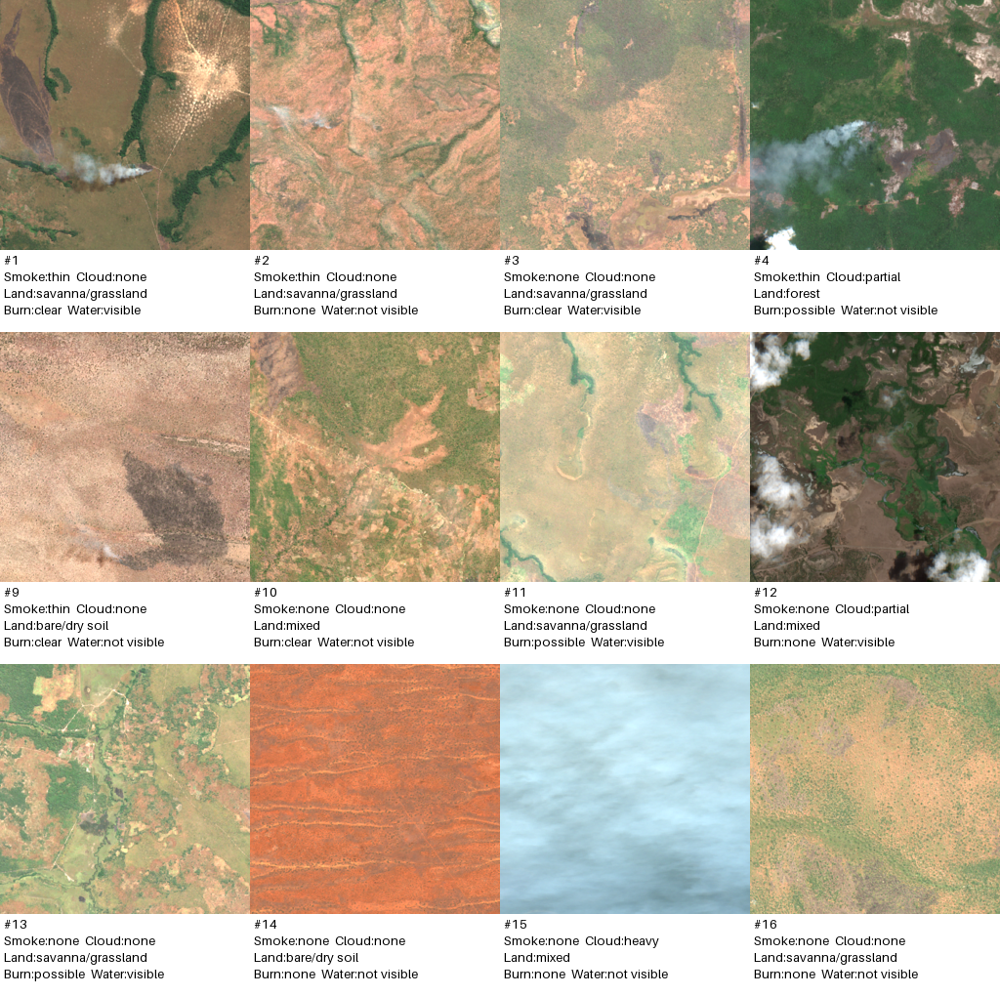
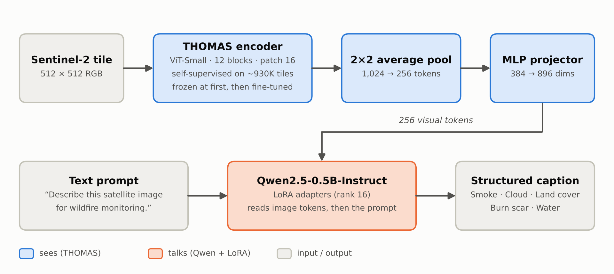
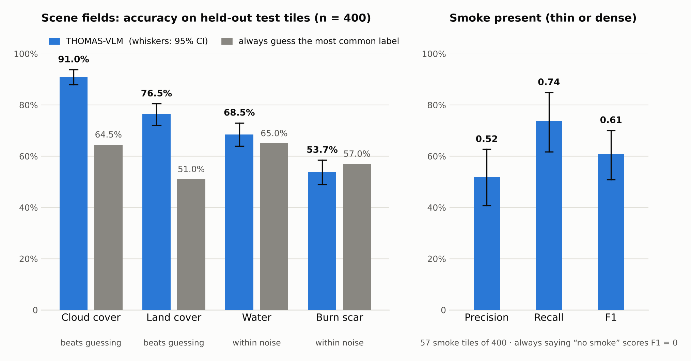
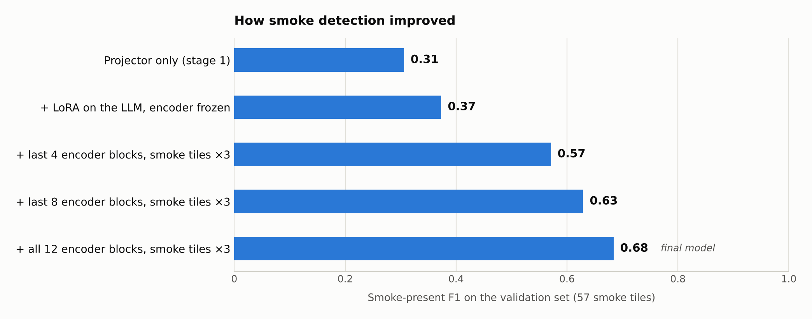

# THOMAS-VLM

**Teaching a small language model to read satellite images of wildfire country.**

A while back I pretrained **THOMAS** ([Transformer for Harmonized Observation via Masked Autoencoding on Sentinel-2 imagery](https://github.com/reshma-merin/Transformer-for-Harmonized-Observation-via-Masked-Encoding-on-Sentinel-imagery)), a self-supervised Vision Transformer that learned what the Earth looks like from about 930,000 Sentinel-2 tiles collected around fire detections. THOMAS is good at *seeing*, but it can't *say* anything.

This project gives it a voice. I connected THOMAS to a small language model (Qwen2.5-0.5B), so that given a 512 × 512 satellite tile it writes a short, structured description: is there smoke, how cloudy is it, what's the land like, are there burn scars, is there water.

Training and evaluation ran on a single GPU, and the captions for the training data came from Claude.

## What it does

You give it a tile and a fixed prompt (*"Describe this satellite image for wildfire monitoring."*). It answers in a consistent five-field format:

```
Smoke: thin. Cloud cover: none. Land cover: savanna/grassland. Burn scar: clear. Water: visible.
```

That's the reference caption for the first tile in the picture below.

## A first look

<p align="center">
  
</p>

<p align="center"><sub>Pilot tiles and the captions Claude wrote for them. Tiles are brightened for display; the tile numbers come from my pilot review sheet.</sub></p>

Sentinel-2 tiles at this scale are hard. Smoke looks a lot like cloud, burn scars look a lot like shadows, and most tiles have no smoke at all (about 14% do). That's what makes this a fun problem.

## How it works

<p align="center">
  
</p>

1. **THOMAS looks at the tile.** The ViT-Small encoder (12 blocks, 16 × 16 patches) turns the image into 1,024 patch embeddings.
2. **Pooling keeps it manageable.** A 2 × 2 average pool brings that down to 256 tokens, so the language model isn't overwhelmed.
3. **A small MLP projector translates.** It maps THOMAS's 384-dimensional features into the language model's 896-dimensional embedding space.
4. **Qwen writes the caption.** Qwen2.5-0.5B-Instruct reads the 256 image tokens followed by the text prompt and writes the caption. It's fine-tuned with LoRA (rank 16, on all attention and MLP projections), so only a tiny fraction of its weights change.

Training happens in two stages:

- **Stage 1: learn to translate.** Only the projector trains, with THOMAS and Qwen frozen (2 epochs, learning rate 1e-3).
- **Stage 2: learn to describe.** LoRA on Qwen, the projector keeps learning, and the whole THOMAS encoder is fine-tuned at a small learning rate (2e-5). Smoke tiles are shown three times per epoch, since they're rare. The loss only counts caption tokens (3 epochs, learning rate 2e-4).

**One detail I'm quietly proud of:** MAE encoders shuffle their patches when they apply masking. If you run THOMAS the usual way, the language model would receive a scrambled picture. So at caption time I run the encoder on the full image with no masking and keep the patches in their original order.

## The data

My pretraining tiles had no text attached, so I had to make the words myself.

- **4,000 tiles** sampled from 3,825 different locations (at most 5 per location, so one huge fire can't dominate).
- **4,000 synthetic captions generated by Claude under a fixed template.** Every caption fills the same five fields:

  | Field | Values |
  |---|---|
  | Smoke | none · thin · dense |
  | Cloud cover | none · partial · heavy |
  | Land cover | forest · savanna/grassland · cropland · bare/dry soil · mixed |
  | Burn scar | none · possible · clear |
  | Water | visible · not visible |

- **Checks I actually ran.** Every caption has to match the template exactly (the script retries until it does, and all 4,000 final captions pass). I also reviewed contact sheets of about 40 pilot tiles next to their captions, which led me to rewrite the prompt twice: once to stop clouds being called smoke, and once to tighten the burn-scar rules. I did not hand-verify the full set.
- **A leak-proof split.** Neighboring tiles of the same landscape look alike, so a random split would flatter the results. I split by **1° geographic block** (about 110 km): 951 blocks, no block appears in more than one split. That gives 3,200 training, 400 validation and 400 test tiles. The validation and test sets each contain 57 smoke tiles.

## Results

All numbers below are on the **held-out test set** (400 tiles from places the model never saw), run once at the end. The whiskers are 95% bootstrap confidence intervals.

<p align="center">
  
</p>

| Field | THOMAS-VLM | Always guess the most common label | What it means |
|---|---|---|---|
| Cloud cover | **91.0%** | 64.5% | Clearly learned |
| Land cover | **76.5%** | 51.0% | Clearly learned |
| Smoke present | **F1 0.61** (95% CI 0.51 to 0.70) | F1 0 (always "none") | Works, with some false alarms |
| Water | 68.5% | 65.0% | Within noise |
| Burn scar | 53.7% | 57.0% | Not learned |

The headline I'm happiest about: the model finds **42 of the 57 smoke tiles** in places it has never seen, and it beats guessing by about 26 points on cloud cover and about 25 on land cover.

### How smoke detection got better

<p align="center">
  
</p>

Training only the small projector gave a model that mostly said "no smoke". Letting the language model adapt helped a little. The big jump came from fine-tuning the THOMAS encoder itself (and showing it smoke tiles more often), which moved validation F1 from 0.37 to 0.68. These are validation numbers, which is why the final test score (0.61) is a bit lower, as you'd expect once you've picked the best variant on validation.

## The honest part

I'd rather you hear the limits from me:

- **The captions are Claude's judgment, not ground truth.** The scores measure agreement with those captions. I haven't yet hand-checked a large sample to measure how often the captions themselves are wrong.
- **Burn scar and water aren't learned.** Both are statistically indistinguishable from always guessing the majority label. Burn scars are subjective even for a person, and small dark patches are exactly the kind of fine detail that's hard at this resolution.
- **Thin vs. dense smoke isn't separated.** Of 11 "dense" test tiles, only 2 were called dense. That's why I report smoke as present or absent.
- **Smoke has false alarms.** About half of the model's smoke alarms are false (39 false alarms among 343 smoke-free tiles), and most of those are borderline "thin" calls.
- **The test set is small.** 57 smoke tiles means wide error bars, so differences of a few points between model variants aren't meaningful.
- **It's one run with one seed.** I compared five checkpoints on the validation set, picked the best, then ran the test set once.

## What's next

- Hand-check about 100 test tiles to put a real error rate on the captions.
- Run a stock off-the-shelf vision-language model (SmolVLM or Qwen2-VL-2B) zero-shot on the same test tiles as a stronger baseline.
- Swap THOMAS for a randomly initialized encoder to measure exactly how much the pretraining contributes.
- Keep all 1,024 patch tokens instead of pooling to 256, in case small smoke wisps are being blurred away.

## What's in the repo

| File | What it does |
|---|---|
| `make_sample.py` | Picks a diverse subset of tiles (at most 5 per location) |
| `caption.py` | Captions tiles with Claude under the template, and builds review contact sheets |
| `split_data.py` | Splits into train, validation and test by 1° geographic block |
| `thomas_vlm.py` | The model, both training stages, and inference |
| `evaluate.py` | Per-field accuracy vs. the majority baseline, plus smoke precision, recall and F1 |
| `analyze.py` | Bootstrap confidence intervals, confusion matrix and an error gallery |
| `thomas_model/model_mae.py` | The THOMAS ViT-MAE architecture (weights live on Hugging Face) |

The tiles, caption files and trained weights are not in the repo (they're large, and the data files contain local paths). The scripts rebuild everything.

## Run it yourself

You'll need an NVIDIA GPU and an [Anthropic API key](https://platform.claude.com) for the captioning step.

The commands below are written for bash. On Windows PowerShell, put each command on a single line (drop the `\` line breaks).

```bash
# 1. Environment (adjust the CUDA wheel to match your driver)
pip install torch torchvision --index-url https://download.pytorch.org/whl/cu128
pip install -U transformers peft pillow anthropic huggingface_hub

# 2. THOMAS weights and code from Hugging Face
python -c "from huggingface_hub import snapshot_download; snapshot_download('reshma-merin-thomas/Thermal-Object-Monitoring-And-Analysis-System', local_dir='thomas_model')"

# 3. Build the dataset from your own folder of 512x512 RGB tiles
python make_sample.py --images_dir path/to/tiles --n 4000 --max_per_group 5 --out sample.jsonl
export ANTHROPIC_API_KEY=...        # PowerShell: $env:ANTHROPIC_API_KEY="..."
python caption.py run --inp sample.jsonl --n 4000 --out captions.jsonl
python split_data.py --inp captions.jsonl

# 4. Train
python thomas_vlm.py train --stage 1 --train train.jsonl --val val.jsonl --out ckpt_s1 --lr 1e-3 --epochs 2
python thomas_vlm.py train --stage 2 --init_proj ckpt_s1/proj.pt --train train.jsonl --val val.jsonl --out ckpt_s2d \
    --lr 2e-4 --epochs 3 --unfreeze_blocks 12 --enc_lr 2e-5 --smoke_repeat 3 --bs 4 --accum 4

# 5. Evaluate
python evaluate.py --ckpt ckpt_s2d --data test.jsonl
python analyze.py --preds preds_ckpt_s2d_test.jsonl --train train.jsonl

# Caption a single tile
python thomas_vlm.py infer --ckpt ckpt_s2d --image path/to/tile.png
```

The tiles themselves are Sentinel-2 RGB exports from Google Earth Engine, placed using NASA FIRMS VIIRS fire detections, and loaded as plain [0, 1] pixel values with no mean/std normalization (exactly as in pretraining).

**Hardware:** one NVIDIA L40 (a 24 GB vGPU slice) on a Windows VM, PyTorch with CUDA 12.8, bf16 mixed precision, batch size 4 with 4 gradient-accumulation steps.

## Thanks

- The ESA Copernicus programme for Sentinel-2, and Google Earth Engine for making it easy to get at.
- NASA FIRMS for the VIIRS active-fire detections that told me where to look.
- *Masked Autoencoders Are Scalable Vision Learners* (He et al., 2021), which THOMAS is built on.
- The Qwen team for Qwen2.5-0.5B-Instruct, and Hugging Face for Transformers and PEFT.
- Claude (Anthropic) for writing the captions, and for patiently debugging this project with me.

---

Built by Reshma Merin Thomas.
